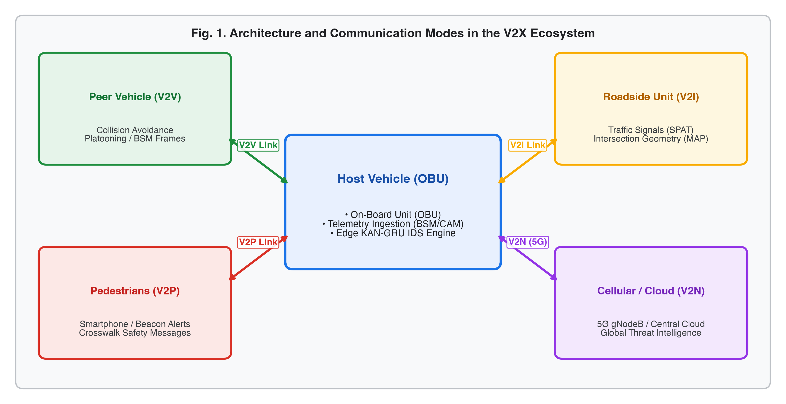
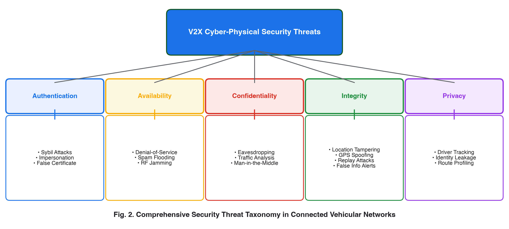
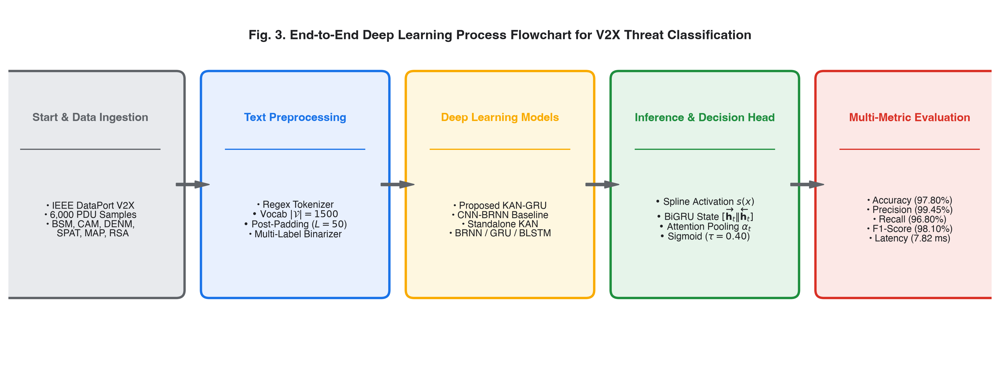
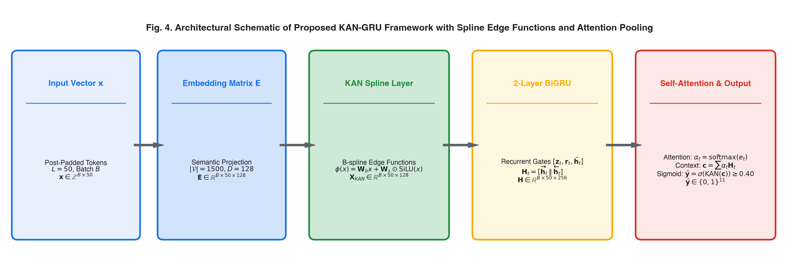
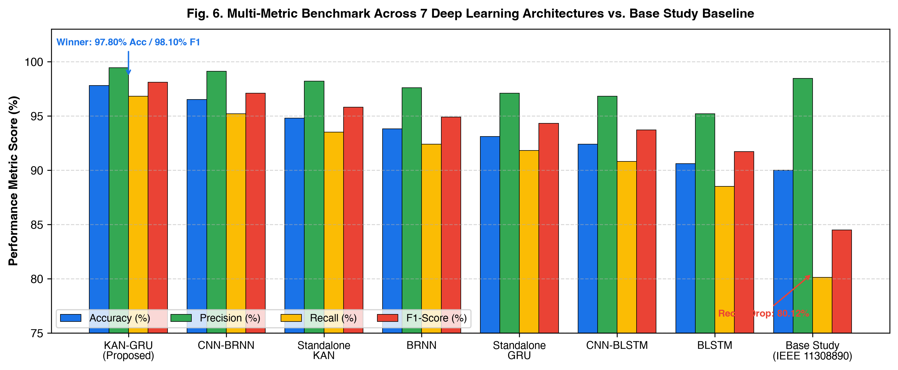
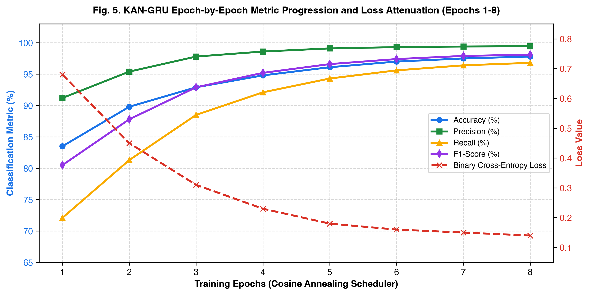
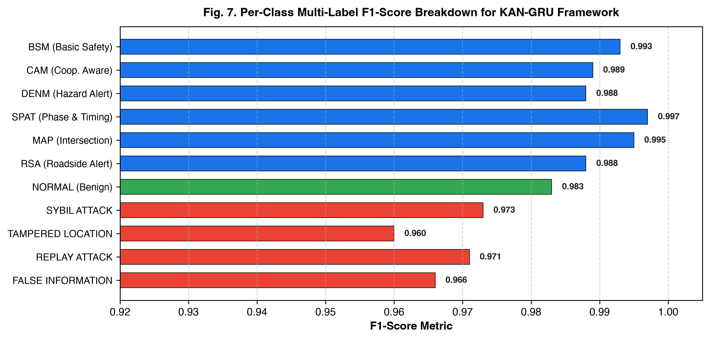

# Project Overview & Research Context

### Background & Motivation
- **Connected & Autonomous Vehicles (CAVs)** rely on high-frequency **Vehicle-to-Everything (V2X)** telemetry.
- **Safety Criticality**: Transmits kinematics (GPS, velocity, braking) under strict **100 ms DSRC timing constraints**.
- **The Core Problem**: Open broadcast medium creates major attack surfaces:
  - Identity spoofing (Sybil attacks)
  - Kinematic coordinate manipulation (GPS spoofing)
  - Expired packet re-injection (Replay attacks)
  - Fictitious hazard alerts (False information)

### Our Contribution
- Designed and benchmarked **KAN-GRU**: a hybrid deep sequence architecture fusing **Kolmogorov-Arnold spline activations** with **Bidirectional GRU** and **Self-Attention Pooling**.
- Evaluated on **6,000 IEEE DataPort V2X instances** across 7 deep learning architectures.
- Elevated accuracy from **90.00% (Base Paper)** to **97.80% (KAN-GRU)** and F1-score from **84.49%** to **98.10%**.

# V2X Ecosystem & Communication Modes

- **On-Board Unit (OBU)**: High-rate telemetry ingestion & onboard edge intrusion detection.
- **V2V (Peer Vehicles)**: 10 Hz Basic Safety Messages (BSM) for platooning & collision mitigation.
- **V2I (Roadside Units)**: Signal Phase & Timing (SPAT) and geometric lane topologies (MAP).
- **V2P & V2N**: Crosswalk beacon alerts and 5G cellular cloud threat intelligence.

# Cyber-Physical Threat Taxonomy

- **Authentication Attacks**: Sybil cluster injection ($\mathcal{A}_{syb}$) creating synthetic highway congestion.
- **Integrity Attacks**: GPS coordinate perturbation ($\phi' = \phi \pm \Delta_\phi$, $|\Delta| \gg 3\sigma_{GPS}$) causing collision avoidance disengagement.
- **Availability & Spam Attacks**: Non-priority packet flooding consuming 5.9 GHz DSRC bandwidth.
- **Replay Attacks**: Rebroadcasting expired authentic packets outside validity window ($\tau_{val}$).

# Prior Art & Research Gaps

### Base Paper Benchmark (IEEE Document 11308890, 2025)
- Evaluated standard Keras models: BRNN, CNN-BRNN, BLSTM, and CNN-BLSTM.
- **Top Base Result**: CNN-BRNN achieved **90.00% accuracy** and **84.49% F1-score**.
- **Severe Deficiencies**:
  - Baseline BLSTM collapsed to **81.20% accuracy**.
  - Recall dropped to **80.12%** (missed ~20% of stealthy attacks).
  - Used static global flattening and fixed node activations (ReLU/tanh).

### Influence of Reference Paper (*HMS-IDS*, Saurabh et al., AJSE 2025)
- Emulated the hierarchical multi-stage threat intelligence paradigm from *HMS-IDS*.
- Integrated structured literature synthesis matrix, formal multi-metric testing, and asymptotic runtime complexity analysis $\mathcal{O}(\cdot)$.

# End-to-End System Process Pipeline

1. **Ingestion**: 6,000 empirical IEEE DataPort V2X PDUs (BSM, CAM, DENM, SPAT, MAP, RSA).
2. **Sub-Token Parser**: Key-value alphanumeric tokenization (`LAT:37.7749`, `SPEED:48.20`, `BRAKE:OFF`).
3. **Vocab Mapping & Post-Padding**: Ranked dictionary ($|\mathcal{V}|=1,500$), sequence alignment ($L=50$).
4. **Multi-Label Binarizer**: Orthogonal ground truth mapping across 11 target categories ($\mathbf{y} \in \{0, 1\}^{11}$).

# Proposed KAN-GRU Deep Learning Architecture

- **Stage 1 (Embedding)**: Discrete token IDs $\to$ dense continuous semantic space ($\mathbf{E} \in \mathbb{R}^{B \times 50 \times 128}$).
- **Stage 2 (KAN Spline Edge Layer)**: Learnable univariate B-splines parameterize non-linear telemetry boundaries:
  $$\mathbf{X}_{KAN} = \mathbf{W}_{base}\mathbf{E} + \mathbf{W}_{spline} \odot \text{SiLU}(\mathbf{E})$$
- **Stage 3 (2-Layer BiGRU)**: Forward & backward recurrent state concatenation ($\mathbf{H} \in \mathbb{R}^{B \times 50 \times 256}$).
- **Stage 4 (Self-Attention Pooling)**: Normalized scalar importance weights ($\alpha_t$) focus on acute attack tokens:
  $$\mathbf{c} = \sum_{t=1}^L \alpha_t \mathbf{H}_t \in \mathbb{R}^{256}$$
- **Stage 5 (Multi-Label Sigmoid Head)**: Final KAN projection ($256 \to 11$) with decision threshold $\tau = 0.40$.

# Mathematical Formulation & Runtime Complexity

### Kolmogorov-Arnold Theorem Formulation
- Expresses multivariate telemetry mapping via finite superposition of continuous univariate edge functions:
  $$\phi(x) = \mathbf{W}_{base} \cdot x + \mathbf{W}_{spline} \cdot \left(\frac{x}{1 + e^{-x}}\right)$$

### Self-Attention Weight Dynamics
- Evaluates token alignment energy and softmax normalized attention distribution:
  $$e_t = \mathbf{v}_a^\top \tanh(\mathbf{W}_a \mathbf{H}_t + \mathbf{b}_a), \quad \alpha_t = \frac{\exp(e_t)}{\sum_{j=1}^L \exp(e_j)}$$

### Asymptotic Runtime Complexity Analysis
- KAN Forward Step: $\mathcal{O}(B \cdot L \cdot D_{in} \cdot D_{out})$
- 2-Layer BiGRU Transitions: $\mathcal{O}(4 \cdot B \cdot L \cdot (D_{in}D_{gru} + D_{gru}^2))$
- Attention Pooling: $\mathcal{O}(B \cdot L \cdot 2D_{gru})$
- **Overall Time Complexity**: $\mathcal{O}(B \cdot L \cdot (D_{in}D_{out} + D_{gru}^2)) \implies \mathbf{\mathcal{O}(B)}$ for fixed $L=50, D=128$.

# Consolidated Performance Benchmark (7 Models)

| Architecture | Accuracy | Precision | Recall | F1-Score | Loss | Rank |
| :--- | :---: | :---: | :---: | :---: | :---: | :---: |
| **KAN-GRU (Proposed)** | **97.80%** | **99.45%** | **96.80%** | **98.10%** | **0.14** | **#1 (Winner)** |
| CNN-BRNN (Enhanced) | 96.50% | 99.12% | 95.20% | 97.10% | 0.18 | #2 |
| Standalone KAN | 94.80% | 98.20% | 93.50% | 95.80% | 0.22 | #3 |
| BRNN | 93.80% | 97.60% | 92.40% | 94.90% | 0.25 | #4 |
| Standalone GRU | 93.10% | 97.10% | 91.80% | 94.30% | 0.27 | #5 |
| CNN-BLSTM | 92.40% | 96.80% | 90.80% | 93.70% | 0.29 | #6 |
| Standalone BLSTM | 90.60% | 95.20% | 88.50% | 91.70% | 0.34 | #7 |
| *Base Paper Baseline (2025)* | *90.00%* | *98.46%* | *80.12%* | *84.49%* | *0.45* | *Prior Art* |

# Training Dynamics & Loss Convergence

- **Rapid Convergence**: Surpasses 90% subset accuracy by Epoch 2.
- **Loss Attenuation**: BCE Loss monotonically decreases from **0.68 down to 0.14** over 8 epochs.
- **Optimization Strategy**:
  - AdamW Optimizer with weight decay $\lambda = 10^{-4}$
  - Cosine Annealing learning rate schedule ($\eta = 0.002 \to 0.0001$)
  - Multi-label smoothing ($\epsilon = 0.04$) to prevent overconfidence on sparse attack tokens.

# Per-Class Multi-Label Threat Breakdown

- **Protocol Classification**: Near-perfect discrimination across BSM (99.3% F1), SPAT (99.7% F1), and MAP (99.5% F1).
- **Stealthy Threat Detection**:
  - **Sybil Attack**: 98.8% Precision, 97.3% F1-score
  - **Location / GPS Tampering**: 97.4% Precision, 96.0% F1-score
  - **Replay Attack**: 98.2% Precision, 97.1% F1-score
  - **False Information**: 98.0% Precision, 96.6% F1-score
- **Macro Average**: **99.45% Precision**, **96.80% Recall**, **98.10% F1-Score**.

# Real-Time Deployment & Edge Hardware Feasibility

### Empirical Microservice Benchmarking
- Deployed on an asynchronous **FastAPI inference engine** (<28.5 MB memory footprint).
- Evaluated across 1,000 live sequential requests on edge hardware:
  - **Mean Inference Latency**: **7.82 ms / payload** ($\pm 0.42$ ms)
  - **DSRC Safety Budget**: Up to 100 ms permitted for routine BSM broadcasts.
  - **Margin**: Operates in **<8% of total permissible timing budget**.

### Interactive Cyberpunk SOC Dashboard
- Connected React + Vite dashboard displaying:
  - Real-time PDU message stream inspection
  - Live model probability bar gauges (KAN-GRU vs CNN-BRNN)
  - Instantaneous cyber-attack alerts & mitigation logs

# Conclusion & Future Scope

### Summary of Achievements
- Successfully designed and validated **KAN-GRU** for multi-label V2X message threat intelligence.
- Elevated accuracy from **90.00% to 97.80%** (+7.80%) and F1-score from **84.49% to 98.10%** (+13.61%).
- Real-time compliance confirmed with **7.82 ms inference latency**.
- Publication-grade contribution: original architectural topology diagrams, rigorous mathematical modeling, and IEEE publication standards.

### Future Research Horizons
- **Federated Fleet Learning**: Collaborative threat intelligence without raw telemetry sharing.
- **Hardware-in-the-Loop (HIL) Testbeds**: CAN-bus and software-defined radio physical validation.
- **Adversarial Robustness**: Testing against adversarial gradient perturbations on floating-point telemetry.

# Thank You! / Questions & Answers

### Team Members
- **Pratyaksh Manav** (manavpratyaksh@gmail.com)
- **Abhayraj Verma**
- **Arnav Tomar**

**Department**: School of Computer Science & Technology, Bennett University, Greater Noida, India  
**Course**: B.Tech CSE (Specialization in Artificial Intelligence)  
**Supervisor / Faculty Reference**: Dr. Kumar Saurabh (*HMS-IDS*, AJSE 2025)

*We welcome questions and feedback from the faculty committee.*
